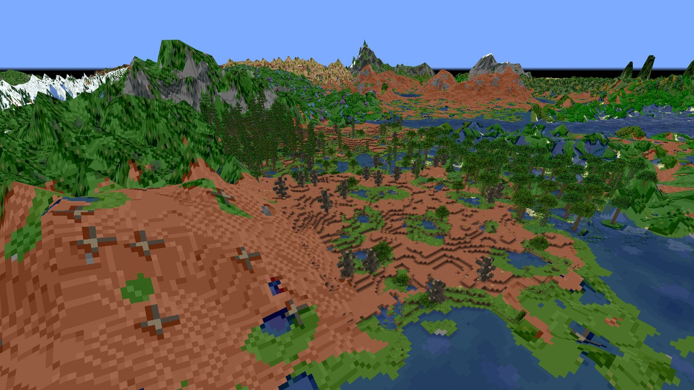
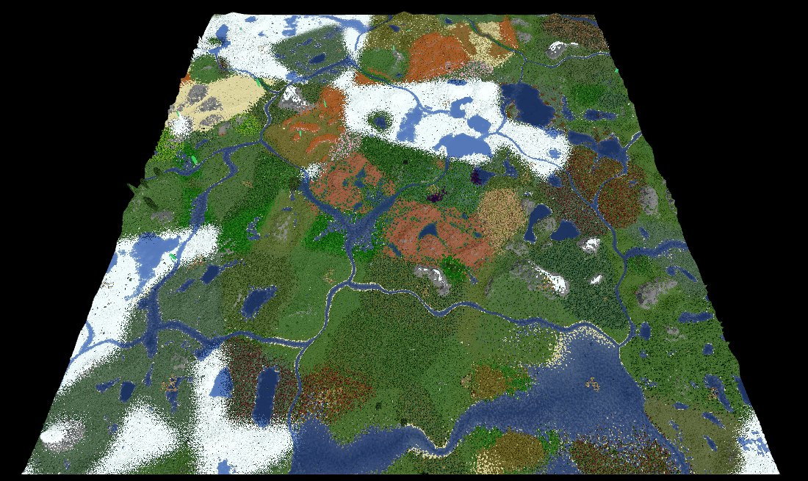
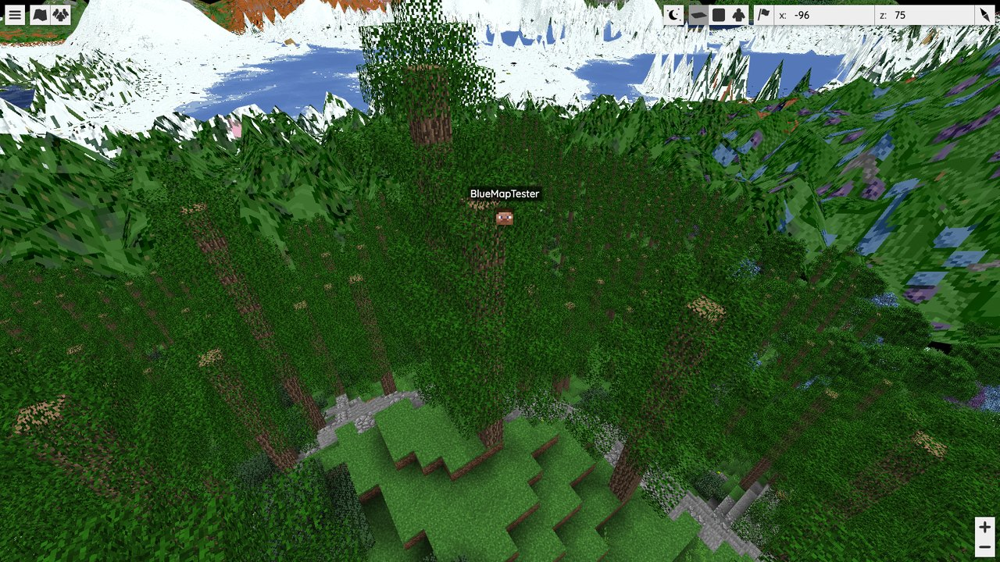
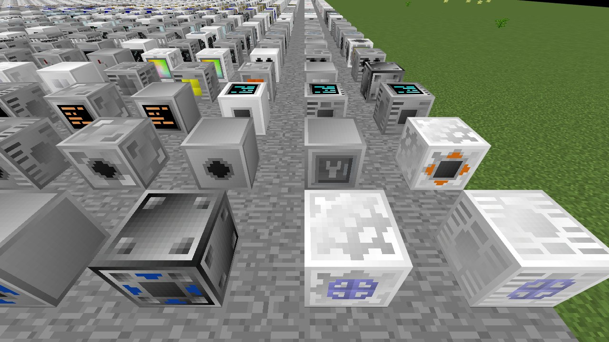
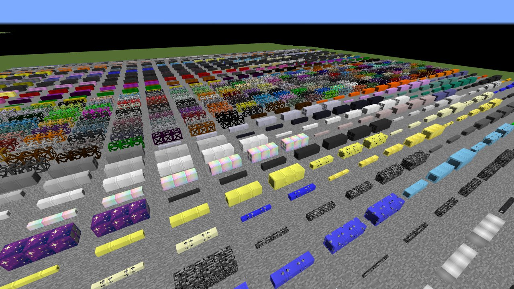
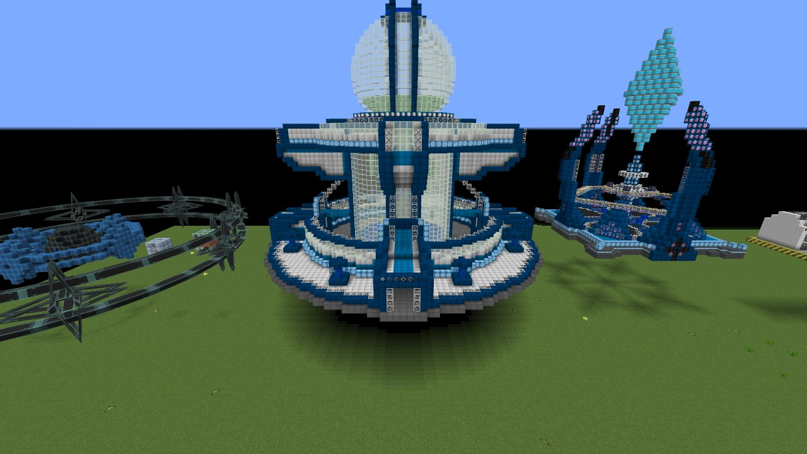
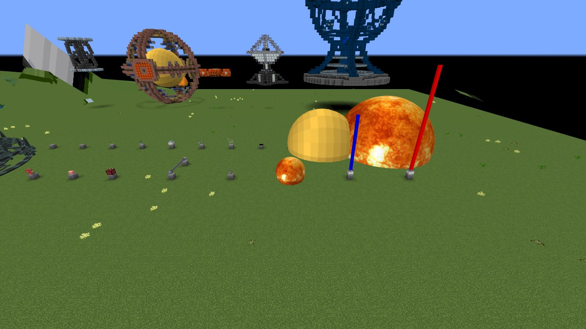
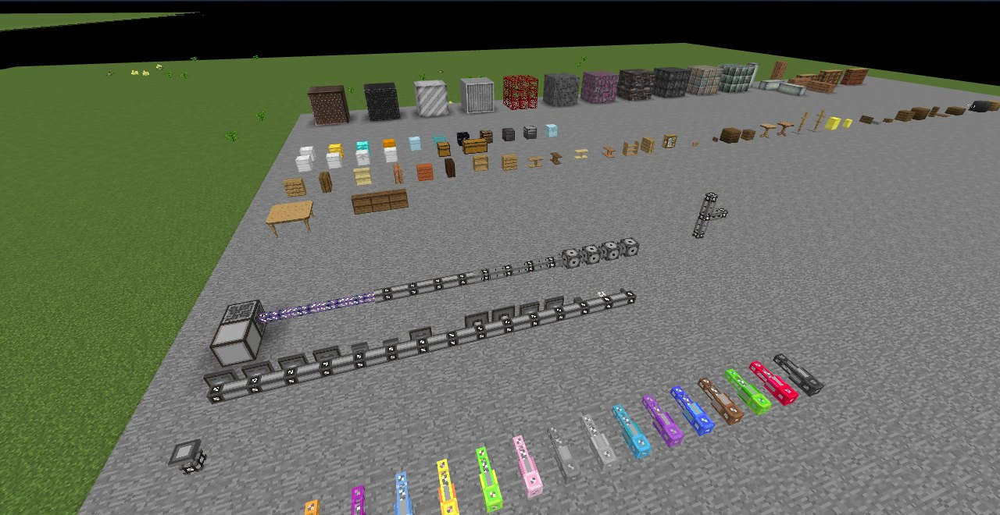
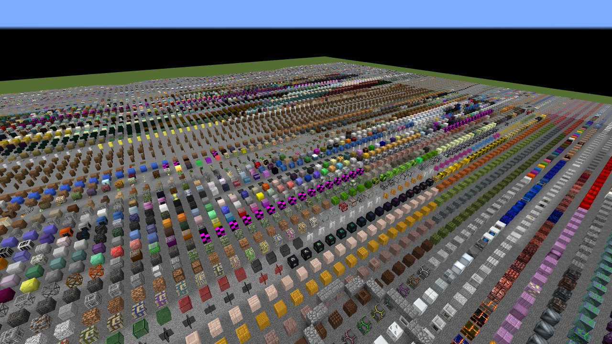
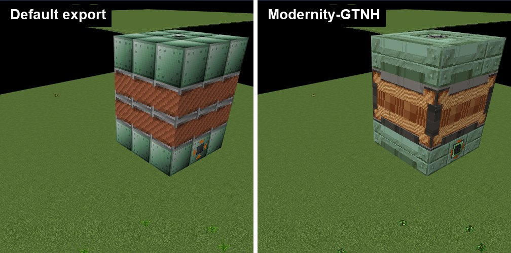

# BlueMap for GT New Horizons (unofficial)

> [!WARNING]
> **Unofficial project. Use at your own risk.**
>
> - This is **not** affiliated with, endorsed by or supported by [BlueMap](https://github.com/BlueMap-Minecraft/BlueMap)
>   or the [GT New Horizons](https://github.com/GTNewHorizons) team. Do not report problems with this port to them.
> - It is **vibe coded**: most of the code, tests and documentation were written by an AI coding agent under human
>   direction. It is tested (see [Status](#status)) but has not been audited.
> - There is **no warranty and no quality guarantee**. It has only been tested on one pack version and one machine.
> - **Back up your world before installing it.** The server mod does not change chunk data, but it runs inside your
>   server process and asks the server to save the world.

A port of [BlueMap](https://bluemap.bluecolored.de/), the 3D web map for Minecraft, to **Minecraft 1.7.10** and the
**GT New Horizons 2.9.0-RC-2** modpack. It runs as a Forge server mod inside the GTNH server, reads the 1.7.10 world
files (including EndlessIDs' extended block IDs and 16-bit metadata), and renders vanilla terrain, GregTech
machines, pipes and ores, and blocks from the pack's other mods into BlueMap's browser map.

Modded blocks look right only with a resource pack that you export yourself from a GTNH client with the bundled
exporter. This project never distributes that pack, because it contains other authors' textures.


*A freshly generated GTNH world (Realistic World Gen, seed 1710), rendered by the server mod.*

## Screenshots

All images are unedited renders from the server mod or the test suite, except for crops and the side-by-side
composition.

| | |
|---|---|
|  |  |
| The whole 256 × 256 chunk test world (65,536 chunks), fully rendered. | A real client logged into the server shows up as a live player marker. |
|  |  |
| GregTech machines and hatches up close, with tier casings and front overlays. | GregTech fluid and item pipes in many materials and sizes. |
|  |  |
| 123Technology's Mega Isa Forge and neighbouring addon multiblocks, formed. | Special renderers for addon blocks: TST and GTNL laser beacons, the TST artificial star, a GTNL essentia jar. |
|  |  |
| Applied Energistics 2 cables, buses and coloured cables; Chisel, Iron Chests and BiblioCraft behind. | Part of the `gtnh-zoo` test scene: about 16,600 block states from the pack's mods in a grid. |


*The same Electric Blast Furnace with the default textures and with the optional
[Modernity-GTNH](https://github.com/ModernityGTNH/Modernity-GTNH) resource pack.*

## Status

Release `v5.29-gtnh.1` (BlueMap 5.29 plus the port). Everything below was measured on GTNH 2.9.0-RC-2.

What works:

- **World reading.** 1.7.10 Anvil regions with EndlessIDs / ChunkAPI extended IDs and metadata, block names from the
  FML registry in `level.dat`. Checked block by block against dumps taken from the live server on 12 test scenes:
  0 mismatches.
- **Vanilla blocks.** 1.7.10 IDs and metadata are flattened to 1.13 block states, including shapes that depend on
  neighbours (stairs, fences, panes, redstone, doors and so on). Compared with a real Minecraft 1.13.2 world upgrade
  over 905,216 positions; every remaining difference is a deliberate choice to keep the 1.7 look.
- **Modded blocks.** The client exporter captures the appearance of every block state the pack registers (4,092
  blocks, 62,476 states from 138 mods). On the `gtnh-zoo` test scene, 91.53% of the placed modded states render with
  their own model (simple bounding-box fallbacks counted).
- **Dedicated renderers** for GregTech machines, pipes, cables, ores and frames; Chisel connected textures; Iron
  Chests; BiblioCraft (partial); Applied Energistics 2 cables, parts and facades; EnderIO conduits.
- **Community addons.** Six addons load, export and render, including their formed multiblocks and key special
  renderers: Twist Space Technology 0.8.0-RC2.9, Programmable Hatches 0.2.0p28, GT: Not Leisure 0.2.7-rc2,
  123Technology 2.2.0, NH Utilities 1.7.0 and the Box++ community fork 2.2.0.0.
- **Server integration.** A map is created automatically for every dimension that has region files; modded
  dimension types and biomes come from the running server; tiles update after world saves; online players appear on
  the map; `/bluemap` commands work in game and over RCON.
- **Performance.** Rendering all 65,536 chunks of a fresh world took 941 s with the default 3 render threads and 556 s
  with 8 threads. The server stayed at 20 TPS in both runs.
- **Tests.** 118 of 118 browser end-to-end screenshot checks pass against approved baselines.

Known gaps:

- BiblioCraft furniture is mostly drawn as boxes (65 of 285 states have a dedicated renderer).
- Applied Energistics 2 and EnderIO render without some details.
- GregTech covers, machines with special (TESR) renderers and pipes inside frame boxes are not drawn.
- 518 block states could not be exported; they show as missing-texture cubes.
- Animated effects are drawn frozen; beams are opaque.
- Exporting needs a desktop session; a headless Docker export is not available yet.
- GT: Not Leisure machine 21153 (Eye of Harmony module) crashes the server on 2.9.0-RC-2 within one tick of being
  placed. This is a GTNL bug, unrelated to this mod.
- Only GTNH 2.9.0-RC-2 has been tested.

## Quick start for server owners

**Requirements**

- A GT New Horizons **2.9.0-RC-2** server, the **Java 17-26** server pack, running on **Java 25** (lwjgl3ify). The
  mod is compiled to Java 25 bytecode and does not load on Java 8. Forgelin, which it needs, ships with the pack.
- A separate copy of the matching GTNH **client** to export textures with. The automated launcher route has only been
  tested on macOS on Apple silicon.
- Memory: our 65,536-chunk test ran with `-Xmx12G`.

**Steps**

1. Back up your world.
2. Download `bluemap-5.29-gtnh.1.jar` from the [releases](https://github.com/Bluemap-GTNH-Unofficial/BlueMap-GTNH/releases)
   and put it in the server's `mods/` folder. Clients do not need it.
3. Start the server once. BlueMap writes its configuration to `config/bluemap/`. Set `accept-download: true` in
   `config/bluemap/core.conf` to let BlueMap download Mojang's client jar for the vanilla textures (this means you
   accept the Minecraft EULA).
4. Export the resource pack from a client copy, with either route:
   - **Launcher (tested on macOS arm64).** Clone this repository (see [Development](#development)) and put the
     [GTNH 2.9.0-RC-2 Java 17-26 MultiMC/Prism instance zip](https://downloads.gtnewhorizons.com/Multi_mc_downloads/betas/GT_New_Horizons_2.9.0-RC-2_Java_17-26.zip)
     in `downloads/`. Then run `uv run gtnh-client export --clean` in `gtnh-exporter/launcher` (see the
     [launcher README](https://github.com/Bluemap-GTNH-Unofficial/gtnh-exporter/blob/main/launcher/README.md)). It
     unpacks a fresh client, runs the exporter and quits; the pack lands in `out/exporter/`. Pass
     `--mod-jar <path to bluemap-gtnh-exporter-0.1.0.jar>` to use the released jar instead of building it.
   - **By hand (untested).** Put `bluemap-gtnh-exporter-0.1.0.jar` into the `mods/` folder of a *copy* of your
     2.9.0-RC-2 client instance and start it. When the main menu appears it exports to
     `.minecraft/bluemap-gtnh-export/` and closes the game. Remove the jar from that copy afterwards.

   Either way you get `bluemap-gtnh-resources-2.9.0-RC-2.zip` (about 27 MB). If your server runs any of the six
   community addons, export from a client that has the same addons installed.
5. Copy the zip into the server's `config/bluemap/packs/` and run `/bluemap reload` (or restart). See the
   [server mod README](https://github.com/Bluemap-GTNH-Unofficial/BlueMap/blob/main/implementations/gtnh/README.md)
   for the exact configuration, generated maps and commands.
6. Open the web map at port 8100 of your server (BlueMap's default, set in `config/bluemap/webserver.conf`).

The community addons need two configuration changes on 2.9.0-RC-2, on both the server and the exporting client:
GregTech `crashOnNullRecipeInput=false` (Twist Space Technology otherwise crashes on start) and GT: Not Leisure
`enableRecipeOutputChance=false` in `GTNotLeisure.cfg` (otherwise TST multiblocks cannot form). The second one
turns off a GTNL gameplay feature.

Optional: the [`modernity`](https://github.com/Bluemap-GTNH-Unofficial/modernity) tool builds packs that give the map
the Modernity-GTNH look from a Modernity release you download yourself.

## Repositories

This is the umbrella repository. Releases are published here; the code lives in submodules that are checked out
next to each other.

| Submodule | Repository | Role |
|---|---|---|
| `BlueMap/` | [Bluemap-GTNH-Unofficial/BlueMap](https://github.com/Bluemap-GTNH-Unofficial/BlueMap) | Fork of BlueMap 5.29 with the 1.7.10 world reader and flattening (`legacy`), GregTech and mod renderers (`gtnh-render`) and the Forge 1.7.10 server mod (`implementations/gtnh`). |
| `gtnh-exporter/` | [Bluemap-GTNH-Unofficial/gtnh-exporter](https://github.com/Bluemap-GTNH-Unofficial/gtnh-exporter) | Client mod that exports modded block appearance and GregTech data into a BlueMap resource pack, plus the `gtnh-client` launcher. |
| `modernity/` | [Bluemap-GTNH-Unofficial/modernity](https://github.com/Bluemap-GTNH-Unofficial/modernity) | Builds optional Modernity-GTNH resource packs for the map. |
| `harness/` | [Bluemap-GTNH-Unofficial/harness](https://github.com/Bluemap-GTNH-Unofficial/harness) | `bmh`, a server-side test mod that builds test scenes and dumps world state over RCON. |
| `orchestrator/` | [Bluemap-GTNH-Unofficial/orchestrator](https://github.com/Bluemap-GTNH-Unofficial/orchestrator) | Headless GTNH server lifecycle, RCON and deterministic test scenes. |
| `e2e/` | [Bluemap-GTNH-Unofficial/e2e](https://github.com/Bluemap-GTNH-Unofficial/e2e) | Browser screenshot tests of rendered maps against approved baselines. |

## Development

```bash
git clone --recursive https://github.com/Bluemap-GTNH-Unofficial/BlueMap-GTNH.git
cd BlueMap-GTNH
mise install java@temurin-25.0.5+8.0.LTS java@zulu-8.98.0.107
```

- **Java** comes from [mise](https://mise.jdx.dev/). Java 25 builds and runs everything; the GTNHGradle mod builds
  also need a Java 8 toolchain (Zulu, the only Java 8 build for macOS arm64).
- **Python tools** (`gtnh-exporter/launcher`, `modernity`, `orchestrator`, `e2e`) use [uv](https://docs.astral.sh/uv/).
- The repositories expect each other as siblings. Each tool finds the workspace as the parent of its own repository
  root; set `BMGTNH_WORKSPACE` to override.
- Local state lives in ignored folders at the workspace root: `servers/`, `clients/`, `downloads/`, `worlds/`,
  `out/` and `sources/`.

Build the server mod:

```bash
cd BlueMap/implementations/gtnh
mise exec java@temurin-25.0.5+8.0.LTS -- ./gradlew \
  -Porg.gradle.java.installations.paths=$(mise where java@zulu-8.98.0.107)/Contents/Home,$(mise where java@temurin-25.0.5+8.0.LTS)/Contents/Home \
  build
```

The first build of each Forge mod decompiles Minecraft and takes about 12 minutes. Each submodule's README has its
own build, test and usage instructions.

## Licence

MIT, except where [NOTICE.md](NOTICE.md) says otherwise: one function adapted from GT: Not Leisure (and two beam
angle lines) stays LGPL-3.0, code adapted from MyCTMLib keeps its MIT notice, and Kotlin re-implementations of
Minecraft behaviour are credited to Mojang. The BlueMap fork keeps the upstream copyright of Blue (Lukas Rieger) and
contributors. NOTICE.md also lists the mods used as references, the libraries in the server jar and the ones the mods
are built against, and the textures in screenshots. Minecraft is a trademark of Mojang; mod names and textures belong
to their authors.
