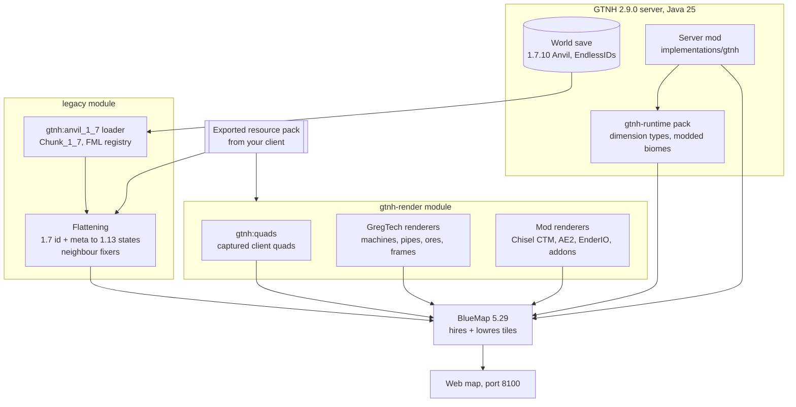
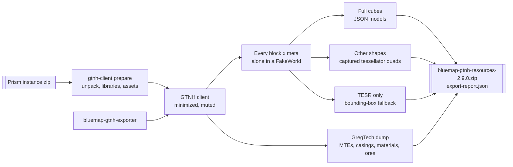
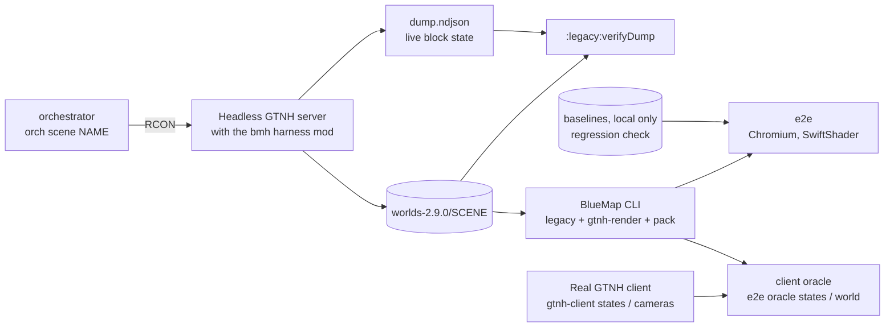

# Architecture

BlueMap renders worlds of Minecraft 1.13 and later. A GTNH world is a Minecraft **1.7.10** world with numeric block
IDs, metadata and hundreds of mods whose blocks are drawn by code. The port therefore adds three things to BlueMap: a
reader for 1.7.10 worlds that turns them into block states BlueMap understands, renderers for blocks that have no
resource-pack model, and a client-side exporter that captures how modded blocks look.

## Overview

| Part | Where | Language |
|---|---|---|
| BlueMap core and common, minimal changes | `BlueMap/core`, `BlueMap/common` | Java (upstream files stay Java to keep rebasing possible) |
| 1.7.10 world reader and flattening | `BlueMap/legacy` | Kotlin |
| GregTech and mod renderers, quad models, coverage report | `BlueMap/gtnh-render` | Kotlin |
| Forge 1.7.10 server mod | `BlueMap/implementations/gtnh` | Kotlin |
| Client exporter mod and launcher | `gtnh-exporter/` | Kotlin, Python |

`legacy` and `gtnh-render` are built as BlueMap addon jars too, so the BlueMap CLI renders scene worlds exactly like
the server mod does.

## World reading

The `gtnh:anvil_1_7` world loader reads 1.7.10 Anvil region files:

- **Extended IDs.** EndlessIDs / ChunkAPI store block IDs above 4095 and 16-bit metadata; the reader supports that
  layout and NotEnoughIDs' `Blocks16`/`Data16` sections (worlds upgraded from GTNH 2.8 keep them until a chunk is
  saved again).
- **Names, not numbers.** Block names come from the FML registry in `level.dat`, so the same block is recognised in
  every world. A legacy block state is identified by its registry name plus a `meta` property.
- **Large chunks.** Chunks longer than 255 sectors are read by their length prefix (an upstream change in
  `MCARegion`).
- **Dimensions.** `DIM<n>` folders map to `gtnh:dim_<n>`, with a 0-256 height range. Dimension types and modded
  biomes come from the running server through the generated `gtnh-runtime` pack.
- **Lighting.** Light data is used whenever a section has it, regardless of the chunk's `LightPopulated` flag (66 of
  576 populated chunks in a fresh world had the flag unset but valid light).

The reader was reconciled block by block with dumps the `bmh` harness took from the live server, on 12 scenes, with
0 mismatches (for example `gtnh-zoo`: 337,995 positions checked).

## Vanilla flattening

BlueMap's resource packs start at 1.13, and 1.7.10 has no block-model JSON. Vanilla blocks are therefore flattened from
`id:meta` to 1.13 block states and rendered with Mojang's 1.13 client jar.

- The table `flattening_1_7_10.tsv` is generated from PrismarineJS `legacy.json`, cross-checked against ViaVersion and
  PaperMC DataConverter, and completed with 1.13.2 property defaults. Lookups go by registry name.
- **Neighbour fixers** compute what 1.7 stored nowhere: stair shapes, fence / iron bar / pane / wall connections,
  redstone wire, door halves, double plants, `snowy`, fence gates in walls, vines, tripwire, chests, fire, repeater
  locks, stems, flower pots, skulls and sign text. They read across chunk borders. Modded blocks take part through
  shapes exported by the client (`data/gtnh/block_shapes.json`): full cube, opaque, solid sides, fence and pane
  connections.
- **Oracle.** A vanilla 1.7.10 world covering every vanilla `id:meta` and neighbour case was upgraded with the official
  1.13.2 server (`--forceUpgrade`) and compared position by position: of 905,216 positions, the 1,505 differences are
  all deliberate (keeping the 1.7 look for unused metas, flower pots, snowy grass, pumpkin faces, stems and brewing
  stand bottles).

## Modded blocks: the exporter

Modded blocks are drawn by code in 1.7.10, and their icons only exist on the client. The exporter is a one-shot client
mod that, once the client reaches the main menu, places every block × meta alone in a fake world and records how the
client draws it.

- Quads are captured with GTNHLib's `TessellatorManager` around the block's own render call, in both render passes.
- Icons are exported as textures; colours (`colorMultiplier` probed in 7 biomes) become grass, foliage or water tints
  or constant colours; `isOpaqueCube` drives culling, and blocks that hide faces against copies of themselves (glass,
  including BartWorks' tiered glass) cull those faces in BlueMap too.
- Connected textures are exported as data: MyCTMLib `.mcmeta` sections with their connection sheets (taken from the
  PNG, not from MyCTMLib's padded atlas copy), and the MCPatcher `method=compact` overrides Angelica loaded (GT's
  BartWorks glass, for example), recorded in the same format. The renderers then connect them by neighbours.
- Resource paths are normalised with one reversible rule shared by the reader and the exporter (uppercase letters
  become `~` + lowercase, other characters a `!` + hex escape), because macOS file systems are case-insensitive and
  names such as `ProjRed|Exploration` do not fit zip paths. The exporter compiles the reader's `ResourceKeys.kt`
  verbatim, so both sides cannot diverge.
- The GregTech dump records, for every MetaTileEntity, the layered textures GregTech would draw on each side for every
  facing and active state, plus casings, materials and the ore texture rule.

## Renderers

Blocks with a resource-pack model are drawn by BlueMap as usual. The `gtnh-render` addon registers renderers for the
rest:

| Renderer | Draws |
|---|---|
| `gtnh:quads` | blocks captured as quads by the exporter |
| `gtnh:gt_machine` | GregTech machines, hatches, multiblock controllers, cables and pipes, from tile-entity NBT (`mID`, facing, active state, connections, colour) and the GregTech dump |
| `gtnh:gt_ore`, `gtnh:gt_frame` | GregTech ores (decoded from the metadata) and frame boxes |
| `gtnh:ctm` and Chisel | connected textures: Chisel's CTM layouts, MyCTMLib's `compact` format and MCPatcher compact sheets; GregTech hatches, buses and controllers connect to their casings through their casing layer, as in the client |
| Mod renderers | Iron Chests, BiblioCraft (partial), AE2 cable bus, parts and facades, EnderIO conduits and facades |
| Addon special renderers | static versions of key TESRs of TST, GTNL and Box++ (and of 123Technology, which is not supported on 2.9.0 until an upstream release loads there) |

Modded IDs without a blockstate are drawn as BlueMap's missing-texture cube instead of leaving a hole. Special
renderers without textures are coloured with a white texture from the exporter and vertex colours. Coplanar quads are
drawn in the client's order: a later quad that covers an earlier one hides it (a Werkstoff block's material icon over
its base, for example), where the web app alone would order them by texture.

## Server mod

`implementations/gtnh` is a Forge 1.7.10 mod (modid `bluemap`) that embeds BlueMap:

- **Packaging.** Compiled to Java 25 bytecode (GTNHGradle's `modern` mode); BlueMap and its libraries are shaded and
  relocated to `de.bluecolored.shadow.*`, and excluded from Forge's class transformers before any of them load.
  Kotlin is not shaded: Forgelin 2.1.10 provides it, and all Kotlin code targets API version 2.1.
- **Server interface.** Worlds, dimensions, players and commands are adapted to BlueMap's server interface. The mod
  generates the runtime pack and the map configs on start (see [maps](/guide/maps)).
- **Saving.** `/bluemap update` saves the dimension on the server thread and waits for the chunk IO thread, instead of
  flushing from a second thread; live updates come from BlueMap's region-file watcher after saves.

## Test tooling

- **`harness`** (`bmh`) is a server-side test mod: block grids ("zoos"), GregTech machines placed like a player
  would, multiblocks built with StructureLib, pre-generation and world dumps, all over RCON.
- **`orchestrator`** starts headless GTNH servers, builds deterministic scenes from an empty level with structure
  generation off on cleared ground, dumps them right after saving and snapshots the world.
- **`e2e`** renders each scene with the BlueMap CLI, opens camera views in headless Chromium with software WebGL and
  compares pixel-identical screenshots with locally approved baselines (a regression check). Its
  [client oracle](/development/oracle) compares BlueMap with the real GTNH client, per block state and per visible
  block face of the scene worlds.

What these checks prove is on the [status page](/status#verification); how to run them is in
[tests & scenes](/development/testing).
